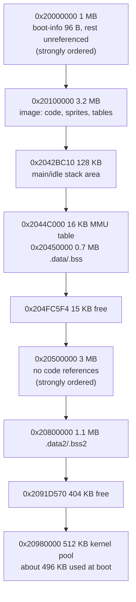

# Project: Doom on the DISPLAY CPU

## Summary

Run the game Doom on the FT-710's front-panel touchscreen (mirrored to the DVI jack), started from a menu entry, with the radio's
stock tasks still running underneath. The operator plays with the main dial, the keys, the touch panel or a USB keyboard, then
leaves Doom and is back on the radio. It is a fun project, not a radio feature.

- Issue: [#7](https://github.com/Reid-n0rc/FT-710_Custom_Firmware/issues/7). The issue holds the feasibility study; this page is the
  source of truth for the design and status from now on.
- Status: **step 1 (free-RAM measurement) done offline.** About **2.5 MB of RAM is free in any reading**, and up to about 4.6 MB
  more depending on two open questions. Nothing has been built, and nothing has touched a radio.

## Status

| Step | State | Pull request |
|---|---|---|
| 1. Offline: measure the DISPLAY's free RAM | done (offline); two runtime checks wait for the JTAG probe | this branch |
| 2. Offline: build doomgeneric for the Cortex-A9 and measure code, BSS and the minimum zone ([#8](https://github.com/Reid-n0rc/FT-710_Custom_Firmware/issues/8)) | todo | – |
| 3. Offline: hook points in the stock image (menu entry, GUI pause, layer, input tap) | todo | – |
| 4. Offline: build the patched DISPLAY `.SFL` and run the D3/D4/§4 checks | todo | – |
| 5. Radio: volatile JTAG test, then SD-card install, play, reinstall stock (owner approval each time) | todo | – |
| 6. Audio, after the transmit-path check | todo | – |

## Background

Upstream facts are from FT-710_Firmware at `12a9988a56a7c9eb1d13e5121084cdb6e3cac043`. Facts marked "step 1" were found for this
page and are reported upstream in [FT-710_Firmware#119](https://github.com/Reid-n0rc/FT-710_Firmware/issues/119). The stock image analysed is DISPLAY V01-08
(`build/FT-710_DISPLAY_V0108.bin`, SHA-256 `65a9b654…d77bb`, as in `upstream/docs/inputs.sha256`).

- **CPU:** Renesas RZ/A1H (R7S721001), Cortex-A9 at about 384 MHz, VFP/NEON **[inference]** (`upstream/docs/code/display/peripherals.md` §1).
- **RAM:** 10 MB on-chip at 0x20000000–0x209FFFFF, no SDRAM **[inference + guess]** (`upstream/docs/hardware.md`, Q6009).
- **Display:** VDC5, four RGB565 800×480 layers; channel 1 mirrors to LVDS → DVI **[fact]** (`upstream/docs/code/display/gui.md`).
- **Input:** 4×4 key matrix plus direct keys, three encoders, TSC2003 touch, USB-host HID keyboard and mouse **[fact]**
  (`upstream/docs/code/display/input.md`).
- **Storage:** SD card with a FAT driver (`fs_fopen` 0x20141ABC, `fs_fread` 0x20142A58) **[fact]**
  (`upstream/docs/code/display/update.md` §2).
- **Kernel:** NORTi µITRON 4.0, 10 ms tick **[fact]** (`upstream/docs/code/display/boot-rtos.md` §4).

### Step 1 result: the DISPLAY RAM map

Method: `tools/display_ram_budget.py` reads the stock image (rebuilt from upstream's Ghidra project by `tools/ghidra_image.py`, because
the Yaesu download is not reachable from every machine) and reports four things. (1) The scatter-load table, with the compressed
regions expanded by a re-implementation of the image's own `__decompress`. (2) Every boot-time allocation from the kernel pool.
(3) The MMU set-up, decoded from the instructions. (4) Every address constant in code and initialised data (32-bit literals, ARM and
Thumb-2 MOVW/MOVT pairs) that points into RAM the static layout doesn't assign. Disassembly was checked by hand with capstone.

| Range | Size | Use | Free for Doom? |
|---|---|---|---|
| 0x20000000–0x2000005F | 96 B | boot-info block (`boot_select_bank` 0x20100ABC writes it, `bootinfo_load` reads it) **[fact]** | no |
| 0x20000060–0x200FFFFF | 1,048,480 B | **no address constant points here** (step 1) **[fact]**. Strongly ordered in the MMU **[fact]** | **depends on O9** (see below) |
| 0x20100000–0x2042BC0F | 3,324,944 B | the image: `.text`, `.rodata` (sprites, fonts), scatter data **[fact]** | no |
| 0x2042BC10–0x2044BD7F | 131,440 B | SYS-mode stack of `main` and the idle loop. `main` starts at SP 0x2044BD80 (step 1) **[fact]**. `reset_in_ram` fills 0x20428840–0x2043FFFF from flash, past the image's end (step 1) **[fact]** | probably mostly unused **[inference]**; needs a JTAG high-water check |
| 0x2044BD80–0x2044BFFF | 640 B | IRQ and SVC/ABT/UND mode stacks (SP 0x2044BFC0 / 0x2044C000) **[fact]** | no |
| 0x2044C000–0x2044FFFF | 16 KB | MMU translation table (4096 × 4 B) **[fact]** | no |
| 0x20450000–0x204FC5F3 | 771,572 B | `.data` + `.bss` **[fact]** | no |
| 0x204FC5F4–0x204FFFFF | 14,860 B | no address constant points here; cacheable **[fact]** | yes |
| 0x20500000–0x205E0C5F | 920,672 B | no `0x205…` constant. If 0x60000000 mirrors 0x20000000, this is `.data_nc`, the SPI DMA buffers, frame buffer fb1 and the scope buffers (`fb_clear_all` clears 0x605048A0 + 0xDC3C0) **[inference]** | **depends on O9** |
| 0x205E0C60–0x207FFFFF | 2,225,056 B | **no address constant points here in either reading** (step 1) **[fact]**. Strongly ordered **[fact]** | **yes** |
| 0x20800000–0x2091D56F | 1,152,368 B | `.data2` + `.bss2` (TCBs, UARTs, GIC table, recorder slots) **[fact]** | no |
| 0x2091D570–0x2097FFFF | 404,112 B | no address constant points here; cacheable **[fact]** | **yes** |
| 0x20980000–0x209FFFFF | 524,288 B | NORTi kernel pool, about 495,608 B allocated at boot (below) **[fact]** | no |

**Free in any reading: about 2.64 MB** (2,225,056 + 404,112 + 14,860 B). Of that, 0.42 MB is cacheable, and 2.12 MB is strongly
ordered until Doom's launcher changes its MMU attributes. **Possibly free:** about 1.0 MB below the image and 0.9 MB at
0x20500000, depending on O9, plus up to about 0.13 MB of the main stack area.

**Kernel pool (step 1, [fact] from the code):**
- **The pool starts at 0x20980000.** `__user_initial_stackheap` (0x201172EC) returns 0x20980000 + 0x80000, and `kernel_heap_init`
  (0x201562B4) passes the word at 0x2010022C (= 0x20980000) to the pool set-up (0x201530FC). This corrects the upstream note
  "heap limit". The pool **ends** at the top of RAM.
- The pool size is computed as (SP − 0x400) − 0x20980000. The SP is 0x2044BD80, below the pool, so the result is negative. The
  first-fit allocator (0x20153B34) therefore never refuses a request: an allocation past 0x209FFFFF would silently go beyond RAM.
- Boot-time allocations: 34 task stacks with their TCBs (the largest are 0x2400 for `audio_codec` and `fwupdate`, and 0x2000 for
  `root`, `uptest`, `sdmenu`, `uart`, `retry`, `cli`, `sdTask` and `fwdbg`), plus the memory pools **`fsys_mpf` 5 × 64 KB =
  320 KB** and "FSYS Work" 5 × 0x1630. That totals **495,608 B**, leaving **at most about 28 KB** for semaphores, flags and
  mailboxes. `dspup` and `test_disp` are never created (`dspup_init` and `test_disp_init` have no caller).
- Every task stack is filled with its task ID at creation (`itron_acre_tsk` 0x201500F4), so a RAM dump shows each stack's
  high-water mark.

**MMU (step 1, [fact] from `reset_in_ram` 0x20100080):** 4096 flat 1 MB sections (VA = PA; the remap helper 0x20100E8C is never
called), all strongly ordered (template 0x00010C02). Only 0x20100000–0x204FFFFF and 0x20800000–0x209FFFFF are then made write-back
cacheable. A `b 0x20100128` at 0x20100100 jumps over three more calls, which would have set 0x60000000–0x602FFFFF and
0x60500000–0x606FFFFF. So the frame-buffer windows stay strongly ordered, and so do 0x20000000–0x200FFFFF and 0x20500000–0x207FFFFF.

**O9: what is at physical 0x60000000?** `task_root` calls `fb_clear_all` unconditionally (call at 0x201170E8). It zeroes 0x60000000 +
0x2FF300 with `memclr` (0x201552C0) **[fact]**. If 0x60000000 were a plain mirror of 0x20000000, that would wipe the running code
at 0x20100000. The radio works, so it is not a plain mirror of that range **[inference, strong]**. Yet the 0x605… buffers look
like a mirror of 0x205… The RZ/A1H address map settles this, and so does a read-only JTAG compare (Plan, step 1b).

### What Doom needs

These are rough targets for step 2 to measure **[guess]**: about 0.4–0.5 MB of code and read-only data, about 0.2 MB of BSS
(renderer tables, visplanes), and a zone of about 1.5–2.5 MB with the WAD read from the SD card on demand. That means **2.1–3.2 MB
in total**, against 2.64 MB free in any reading. It fits if step 2 shows the zone can be at most about 2 MB. If not, the O9 ranges
are needed.

## Design

**DISPLAY only; MAIN, IFDSP and SDR stay stock.** Doom is an add-on patch to the stock DISPLAY image, never a replacement, because
the SD-card updater runs inside the DISPLAY bank image (rule 4, [safety.md](../safety.md) D3).

- **Launch:** a menu entry (owner decision, 2026-10-29). Step 3 finds the menu table and the hook.
- **Where Doom lives:** the stock image is 3.2 MB in a 6 MiB bank, so Doom's code can sit in the bank after the stock image without
  changing the stock layout. The launcher copies it into 0x205E0C60–0x207FFFFF at start-up. While Doom runs, the launcher marks the
  1 MB sections 0x20600000–0x207FFFFF write-back cacheable; nothing else uses them, and it restores them on exit. Static data and the
  zone go there and in 0x2091D570–0x2097FFFF.
- **Never touch the kernel pool.** It has about 28 KB left and no limit check. Doom must not create tasks with pool stacks beyond
  one small launcher task; Doom's own stack comes from its own region.
- **Video:** 320×200, palette → RGB565, scaled 2× into one of the existing 800×480 layers.
- **Input:** main dial = turn; second encoder = forward/back; keys = fire, use, strafe, weapon; touch for menus; USB keyboard through
  the empty HID chain 0 (0x208DC198).
- **WAD:** user-supplied on the SD card (Freedoom recommended), read on demand; never committed.
- **Audio:** the first version is silent (owner decision, 2026-10-29); audio comes in step 6, after the transmit-path check.

Alternatives considered: a stand-alone DISPLAY image (rejected: removes the updater, rule 4); running on the IFDSP, MAIN or SDR
(rejected in the issue: no display, too little RAM, or a full FPGA); a reboot-to-Doom mode that reuses GUI memory (kept as a
fallback if step 2 needs more than 2.6 MB).

## Delivery and the way back

- **Images changed:** DISPLAY only, as a standard `.SFL` (D1, D2). The patch adds the Doom code after the stock image in the bank
  and a menu hook; every update-path function stays byte-identical (D3); the image stays under 6 MiB (D4). The version characters
  sort below `0108` (D5).
- **Locks and options (§4):** the DISPLAY image has none to change; nothing else changes.
- **If something goes wrong:**

| Situation | Path back |
|---|---|
| Doom works but is unwanted | install the factory DISPLAY `FT-710_DISPLAY_V0108.SFL` (D7) |
| Doom crashes or hangs while playing | power-cycle; Doom only runs after the menu entry is used, so boot is unaffected |
| The patched DISPLAY doesn't boot | maintenance/loader mode, or JTAG J6003 to restore the bank flags (exact steps to be written before step 5) |
| Radio behaviour changes while Doom runs (MAIN link, scope) | leave Doom; if it persists, reinstall stock |

## Risks

| Risk | Likelihood | Impact | Mitigation | Path back |
|---|---|---|---|---|
| Not enough RAM (zone too small in 2.64 MB) | M | H | Step 2 measures the minimum zone offline; O9 and the stack area may add up to about 2 MB | reboot-to-Doom mode |
| 0x205E0C60–0x207FFFFF is used at run time through a computed address that the constant scan misses | L | H | Step 1b: two read-only JTAG reads minutes apart while the radio runs | pick another range |
| Doom overruns the kernel pool (no limit check) | L | H | no pool allocations by Doom | reinstall stock |
| Starving the MAIN link or SPI DMA | M | M | Doom task below every stock priority, sleeps each frame | leave Doom |
| Audio reaches the transmitter | L | H | silent until the routing is proven | — |
| GPL-2.0 Doom linked into Yaesu's image | — | legal | source-only patches; built images never distributed (rule 3) | — |

## Plan

1. **Measure the free RAM offline** — done. Result: the RAM map above; test: `tools/display_ram_budget.py`.
   - **1b (needs the JTAG probe and the owner's approval for read-only access):** read 0x20100000 and 0x60100000 (16 bytes each) and
     compare them (settles O9). Read 0x205E0C60–0x207FFFFF and 0x2091D570–0x2097FFFF twice, five minutes apart, while using the
     radio (scope, touch, recording); unchanged means unused. Read 0x2042BC10–0x2044BD80 to find the main-stack high-water mark.
     These are reads only, no writes.
2. Build doomgeneric for the Cortex-A9 (`arm-none-eabi-gcc`, hard-float) with stub back-ends. On the host, run the shareware and
   Freedoom demos with decreasing zone sizes. Result: code, data and BSS sizes, and the smallest zone that plays all demos.
3. Find the hook points in the stock image (menu entry, GUI pause, layer ownership, input tap). Result: patched addresses with old
   and new bytes.
4. Build the patched DISPLAY `.SFL`; `sfl_encode.py --check`, the D3 byte-compare. Result: SHA-256 of input and output.
5. Radio, with the owner's approval each time: a volatile JTAG load first, then the SD-card install, play, and reinstall stock (D7).
6. Audio, after the transmit-path check.

## Test log

| Date | What | Result |
|---|---|---|
| 2026-10-29 | `tools/ghidra_image.py --upstream <FT-710_Firmware @ 12a9988>` for DISPLAY, MAIN, IFDSP (offline) | all three images rebuilt; SHA-256 equal to `upstream/docs/inputs.sha256` |
| 2026-10-29 | `tools/display_ram_budget.py build/FT-710_DISPLAY_V0108.bin` (offline) | RAM map above; kernel pool 495,608 of 524,288 B used; no address constant in 0x20000060–0x200FFFFF, 0x204FC5F4–0x207FFFFF or 0x2091D570–0x2097FFFF (6 ASCII false hits listed by the tool) |
| 2026-10-29 | Hand disassembly (capstone) of `reset_in_ram`, `__user_setup_stackheap` 0x201561C0, `__user_initial_stackheap`, `kernel_heap_init`, the pool set-up and allocator, `fb_clear_all` (offline) | as cited in Background |

No radio was touched.

## Decisions

| Date | Decision | By |
|---|---|---|
| 2026-10-29 | Go ahead with step 1 (free-RAM measurement) | owner (issue #7 conversation) |
| 2026-10-29 | Doom is launched from a **menu entry** | owner |
| 2026-10-29 | The owner will get a JTAG probe, so step 5 starts with a volatile JTAG test, and step 1b can run once it arrives | owner |
| 2026-10-29 | The first version is **silent**; audio waits for step 6 and the transmit-path check | owner |

## Open questions

- **O9: what is at physical 0x60000000–0x602FFFFF?** Answered by the RZ/A1H hardware manual's address map ("RZ/A1H Group, RZ/A1M
  Group User's Manual: Hardware", Renesas R01UH0403EJ) and by the read-only JTAG compare in step 1b. Reported upstream:
  [FT-710_Firmware#119](https://github.com/Reid-n0rc/FT-710_Firmware/issues/119).
- Is the main-stack area (0x2042BC10–0x2044BD7F) really unused below its high-water mark? → step 1b.
- How small can Doom's zone be with the WAD on the SD card? → step 2.
- Does the playback-PCM path reach the transmitter? → before step 6 (needs the DSP-side routing documented upstream).
