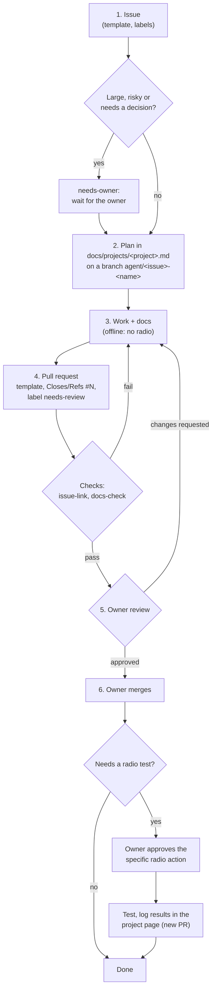

# Workflow: agents do the work, the owner reviews

This page describes how a piece of work moves from an idea to `main`. The rules behind it are in [AGENTS.md](../AGENTS.md); what the
reviewer checks is in [review.md](review.md).

## Overview

## 1. Issues

- Every piece of work starts from an issue in this repository. Use a template: **Project** (a new feature), **Task** (one step of a
  project) or **Question**.
- Labels say which chips are involved (`main`, `display`, `ifdsp`, `sdr`, `cat`), whether the radio is needed (`needs-radio`,
  `validate-on-radio`) and whether the owner must decide something first (`needs-owner`).
- A project issue links its project page. Task issues are created per step and link back to the project issue.

## 2. Planning

- The project page in `docs/projects/` is the **source of truth** for the design and the plan; the issue is the discussion and the
  status. Keep them consistent: when the plan changes, change the page and say so in the issue.
- Before code or patches, write the approach on the page and open a pull request for the plan if the work is large. A plan that the
  owner has reviewed saves rework.
- Each step has one verifiable result (a document, a script plus its test, a patch plus its offline check).

## 3. Doing the work

- Branch: `agent/<issue>-<short-name>`. One pull request per branch.
- Work offline: upstream decompiles and docs, simulation, offline image checks. A radio is used only after review and the owner's
  approval for that specific action ([safety.md](safety.md)).
- Write the documentation as you go ([documentation-standard.md](documentation-standard.md)). A pull request without its docs fails
  `docs-check`.
- Cite upstream facts with the pinned upstream commit ([upstream.md](upstream.md)). If you find something new about the stock
  firmware, report it upstream (`upstream-finding`).

## 4. Pull requests

- Use the template. Fill in every section; write "none" where something does not apply.
- Link the issue: `Closes #N` when the pull request finishes it, `Refs #N` when it is one step.
- Add the label `needs-review` and stop. Do not merge, do not ask for a bypass.
- Checks:
  - **issue-link**: the description links an issue in this repository.
  - **docs-check**: changes outside `docs/` come with changes in `docs/`; project pages have the required sections; relative links
    in `docs/` resolve.

## 5. Review and merge

The owner reviews against [review.md](review.md), asks for changes on the pull request, and merges. Agents run with the owner's
GitHub account, so GitHub can't record a formal approval from the owner on an agent's pull request; the owner's merge (through the
ruleset's pull-request bypass) is the approval. Direct pushes to `main` are blocked for everyone.

## 6. After the merge

- If the work needs a radio test, the owner approves the specific action; the agent (or the owner) runs it and records the result
  in the project page's test log in a new pull request.
- Close the issue when its result is merged and, where needed, tested.

## Upstream updates

The `upstream-sync` workflow checks FT-710_Firmware every day. When upstream has moved, it opens a pull request that bumps the
`upstream/` pin and lists the new upstream commits and the changed upstream docs. The owner reviews whether any project relies on
something that changed ([upstream.md](upstream.md)).
